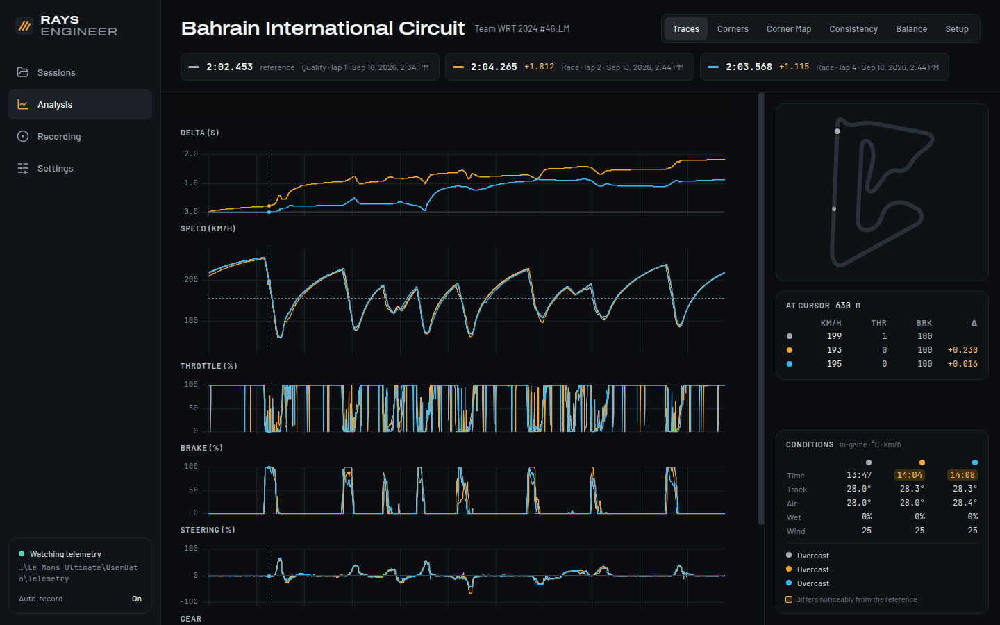

# Rays Engineer

Free, offline telemetry analysis for **Le Mans Ultimate**, **Assetto Corsa**, **Assetto Corsa
Competizione** and **Assetto Corsa Rally** — a Windows desktop app. For LMU it reads the telemetry
recordings LMU writes itself; the other games are recorded live by the app. You compare laps (or
rally stage runs) against your best one by distance.

## Download

**[Latest release](../../releases/latest)** — download `Rays.Engineer.Setup.<version>.exe` and run it.
All versions: [Releases](../../releases). What changed: [`CHANGELOG.md`](CHANGELOG.md).

This repository only holds the downloads, this README and the changelog. The source code is not public.

## Install

1. Run the installer. It is not code-signed, so Windows SmartScreen warns: **More info → Run anyway**.
2. Pick your game on the first screen.
3. LMU: _Automatically Record Telemetry_ must be on — the app shows its state on the **Recording**
   page and can switch it (close LMU first). AC / ACC / AC Rally: nothing to set up, keep
   Rays Engineer open while you drive.

Requirements: Windows 10 or 11, 64-bit.

## Features

- Delta, speed, throttle, brake, steering and gear against a reference lap, synced charts and zoom,
  plus any other recorded channel (tyre temperatures, pressures, fuel, …)
- Track map, corner table and corner map (lines, brake point, apex, throttle-on per lap)
- Consistency, theoretical best, under-/oversteer estimate, setup comparison
- Live voice feedback: a race-engineer call after every valid lap (AC, ACC) and a debrief after each
  rally stage (AC Rally), German or English
- Export and import sessions (`.rses`) and single laps (`.rlap`)
- Optional: ask Claude where you lose time — through Claude Desktop or Claude Code on the same PC

## Privacy

No account, no cloud, no network access: the app blocks every outgoing request, your data stays on
your PC. The optional Claude integration is off until you connect it, and runs through *your* Claude
app, which sends what Claude reads to Anthropic.

## Bugs and feedback

On Discord: **[discord.gg/FykQBSSHF8](https://discord.gg/FykQBSSHF8)** — bugs in `bug-reports`,
ideas in `ideas`. Issues and pull requests are switched off here.

## Why GitHub?

Rays Engineer is a free hobby project. A website of its own would cost a monthly fee; GitHub hosts
the downloads for free, so the app stays free.

## License

[PolyForm Noncommercial License 1.0.0](https://polyformproject.org/licenses/noncommercial/1.0.0/) —
you may use and share Rays Engineer for any noncommercial purpose. Commercial use is not permitted.
